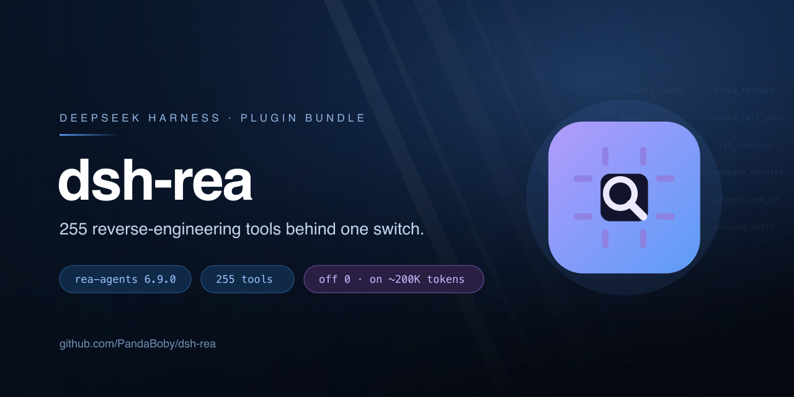
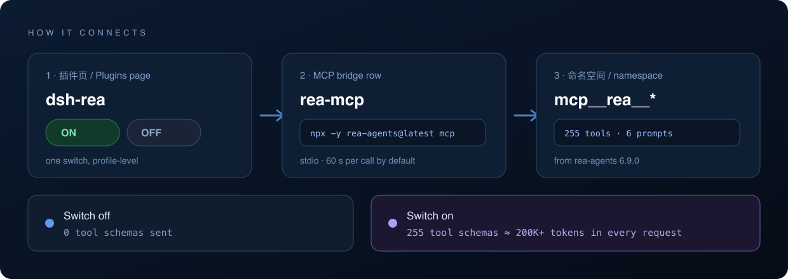

<div align="center">

[中文](./README.zh.md) · **English**



# dsh-rea

### 255 reverse-engineering tools behind one switch.

A [DeepSeek Harness](https://github.com/deepseek-ai/deepseek-harness) plugin bundle that mounts the
**REA (Reverse Engineer Anything)** MCP server as the `rea` tool namespace — on while you are
investigating, off the moment you are done.

[](./LICENSE)


[](https://www.npmjs.com/package/rea-agents)

[Quick start](#quick-start) · [Cost](#cost) · [Why a bundle](#why-a-bundle) · [Requirements](#requirements) · [Configuration](#configuration) · [Troubleshooting](#troubleshooting) · [FAQ](#faq) · [Development](#development)

<code>dsh plugin add github:PandaBoby/dsh-rea</code>

</div>

> [!IMPORTANT]
> While the switch is on, all 255 REA tool schemas travel in **every** request — roughly 200K+
> tokens of context at `rea-agents@6.9.0`. That is the whole point of the switch: turn it off when
> the investigation ends.

**What it is** — one MCP bridge row, packaged so the Plugins page can show it as a card.
**What it is not** — no analysis engine, no tool implementation, no model code. Every REA tool comes
from the `rea-agents` npm package at run time.

<div align="center">

</div>

Three artefacts, one chain: the Plugins page carries the **dsh-rea** card, the card composes the
**rea-mcp** bridge row, and the row is what brings the **`rea`** namespace into a session — with
255 tool schemas attached while it is on, and none while it is off.

## Quick start

### 1. Install

```sh
dsh plugin add github:PandaBoby/dsh-rea
```

`dsh plugin add` also selects the bundle, so the `rea` tools appear right away. Working on this
package itself? Install from your checkout instead:
```sh
dsh plugin add /absolute/path/to/dsh-rea
```

### 2. Make sure the engine can start

```sh
npx -y rea-agents@latest --version   # prints 6.9.0 or newer on a supported runtime
```

The engine is not downloaded at install time: the bridge runs `npx -y rea-agents@latest mcp`, so the
first tool sync after the switch is on fetches the newest release and caches it. If this command
fails, see [Requirements](#requirements).

### 3. Ask for something

**Plugins page → Installed plugins → dsh-rea → On**, then prompt as usual:

```text
Work out how the search feature in <app> works, show the evidence, then implement something similar in my project.
```

Tools register as `mcp__rea__*`. When the investigation is over, turn the switch back off.

## Cost

The `rea` namespace is expensive because its schemas are sent with every request:

| State | Tools sent | Tool-definition context |
| --- | --- | --- |
| dsh-rea off | built-in tools only | ~2K–8K tokens |
| dsh-rea on | built-in + 255 | **~200K+ tokens** |

Measured against `rea-agents@6.5.0` on a 1M-token window: the schemas serialize to ~790 KB, which
the harness prices at ~207K tokens, roughly 20% of the window. The figure moves with the REA release:
at 6.9.0 the same list holds 255 tools and its raw `tools/list` JSON weighs 4.44 MB, against 207
tools and 2.94 MB at 6.5.0.

To measure it yourself, the context gauge above the composer splits usage into system prompt, tool
definitions and messages: compare the tool-definition line with the switch on and off. Or read the
newest `request/header` in `~/.dsh/sessions/` and count the `mcp__rea__*` entries.

## Why a bundle

Dropping the same six lines into `~/.dsh/cordis.patch.yml` works, but that row is invisible to the
Plugins page — the page lists **bundles** (packages that carry a `dsh.bundle.patch`), not
free-standing rows. Wrapping the row in a bundle is what turns it into a switch you can click, and
click back off after the investigation.

## Requirements

- DeepSeek Harness with a Plugins page (Desktop and Web profiles both have one).
- **Node `^22.23.4 || ^24.22.1 || >=26.12.1`.** `rea-agents` 6.8.0 and later refuse to start on
  anything older: the server prints the requirement and exits, so the bridge ends up with zero tools
  instead of an error.
- Network access the first time the switch is turned on, so `npx` can fetch the newest release.
  Later starts reuse the npm cache.

## Configuration

Defaults live in [`cordis.patch.yml`](./cordis.patch.yml). Override the `rea-mcp` row from your
profile patch when you need to pin a REA version, raise the call timeout for slow decompilation, or
make startup failures loud:

```yaml
- id: rea-mcp
  config:
    serverName: rea
    transport: stdio
    command: npx
    args: ["-y", "rea-agents@6.9.0", "mcp"]
    toolCallTimeoutMs: 600000
    failOnStartupError: false
```

A patch **replaces** a row's whole `config` rather than merging into it, so restate every key you
want to keep.

| Key | Default | Meaning |
| --- | --- | --- |
| `serverName` | `rea` | Namespace of the tool names (`mcp__rea__<tool>`); max 32 chars |
| `command` / `args` | `npx` + `-y rea-agents@latest mcp` | The stdio server to launch |
| `toolCallTimeoutMs` | `60000` | Per-call budget; raise it for long analyses |
| `failOnStartupError` | `false` | When `true`, a failed start raises instead of silently yielding no tools |
| `reconnect` | built-in policy | Retry and backoff when the child process drops |

## Troubleshooting

| Symptom | Cause | Fix |
| --- | --- | --- |
| No `rea` namespace at all | Bundle not selected in the profile | Turn the switch on; if you added it as a plain dependency, add it to `dsh.profile.bundles` too |
| Namespace exists, zero tools | The engine refused to start — usually an unsupported Node, or `npx` could not reach the registry on first sync | Run `npx -y rea-agents@latest --version` in the same environment; set `failOnStartupError: true` to surface the next failure |
| Tools appear, calls time out | Default 60 s per-call budget | Raise `toolCallTimeoutMs` |
| You need a fixed engine | `@latest` drifts with every release | Pin `rea-agents@x.y.z` in `args` |

If you added `dsh-rea` to a profile as a plain dependency rather than through `dsh plugin add`, the
bundle is never composed: the profile's `dsh.profile.bundles` list is what selects it.

## FAQ

<details>
<summary><strong>Do I have to install REA separately?</strong></summary>

No. The bundle only declares the connection; `npx` fetches the newest `rea-agents` release on the
first sync after the switch is on. REA's own procedure guidance for the model is a separate skill,
deliberately not duplicated here.

</details>

<details>
<summary><strong>Does it upload the app I am analysing?</strong></summary>

This package contains no code — it declares one MCP row. Analysis runs locally through REA; what
reaches a model is the tool results, under your own provider's data policy.

</details>

<details>
<summary><strong>What happens to a running call when I turn the switch off?</strong></summary>

The row is withdrawn, the child process is disposed and the call is cancelled. Later requests are
~200K tokens lighter. With HMR on (the Desktop and Web default) no restart is needed; without HMR
the change applies on the next start.

</details>

<details>
<summary><strong>Why did the tool count change from 207 to 255?</strong></summary>

The schema count follows the engine, not this package. `rea-agents@6.9.0` serves 255 tools; the
[bundle patch](./cordis.patch.yml) tracks `@latest`, so the number moves when REA ships. Pin a
version if you need it stable.

</details>

<details>
<summary><strong>How do I uninstall it?</strong></summary>

Plugins page → dsh-rea → **Remove**. Removal withdraws the row and allows deleting the package.
`npx` caches live outside the profile and stay until npm or `npx` cleans them up.

</details>

## Development

```sh
npm ci
npm run validate
```

`npm run validate` checks everything that can rot without anyone noticing: required manifest fields
and the paths they point at; that `cordis.patch.yml` parses as one `insert` of the `rea-mcp` row
using an `npx … mcp` command; that the `en` and `zh` locale cards expose the same keys; that the icon
is a real SVG; and that the newest [`CHANGELOG.md`](./CHANGELOG.md) entry matches `package.json`.
CI runs the same check on Node 22 and 24.

There is no source code to test here: the engine lives in `rea-agents`, and this repository only
declares how to reach it.

## Further reading

- [REA repository](https://github.com/morluto/rea) — what the tools do and how to drive them.
- [`rea-agents` on npm](https://www.npmjs.com/package/rea-agents) — releases and version history.
- [`CHANGELOG.md`](./CHANGELOG.md) — what changed in this bundle, and when.

## Contributing

Issues and pull requests are welcome: [PandaBoby/dsh-rea](https://github.com/PandaBoby/dsh-rea/issues).
Run `npm ci && npm run validate` before opening a pull request; CI runs the same command on Node 22
and 24. Bug reports about analysis behaviour belong to the
[REA repository](https://github.com/morluto/rea) instead.

## License

MIT — see [LICENSE](./LICENSE). REA itself is a separate project under its own license; this package
only declares how to connect to it.
