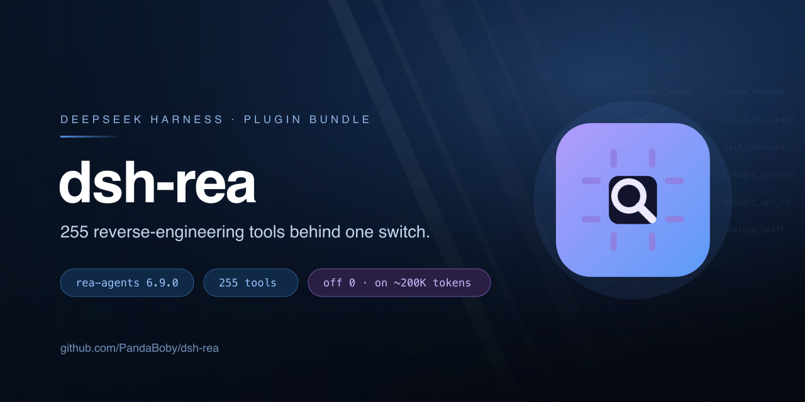
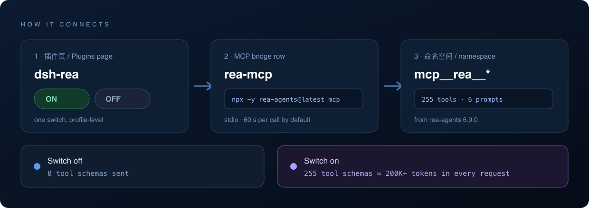

<div align="center">

**简体中文** · [English](./README.md)



# dsh-rea

### 255 个逆向工具，藏在一个开关后面。

[DeepSeek Harness](https://github.com/deepseek-ai/deepseek-harness) 的插件包，把
**REA（Reverse Engineer Anything）** 的 MCP 服务器挂载成 `rea` 工具命名空间——
调查时打开，查完就关。

[](./LICENSE)
[](https://www.npmjs.com/package/@panda-boby/dsh-rea)


[](https://www.npmjs.com/package/rea-agents)

[快速开始](#快速开始) · [成本](#成本) · [为什么做成 bundle](#为什么做成-bundle) · [运行要求](#运行要求) · [配置](#配置) · [排错](#排错) · [常见问题](#常见问题) · [开发](#开发)

<code>dsh plugin --profile desktop add @panda-boby/dsh-rea</code>

</div>

> [!IMPORTANT]
> 开关打开期间，255 个 REA 工具 schema 会跟着**每一次**请求发送——在 `rea-agents@6.9.0` 上约
> 200K+ tokens 上下文。这正是开关存在的理由：调查结束就关掉。

**它是什么** —— 一行 MCP 桥接配置，被包装成 bundle，才能出现在插件页变成卡片和开关。
**它不是什么** —— 不含分析引擎、工具实现或模型代码。所有 REA 工具都在运行时从 `rea-agents`
包中发现。

<div align="center">

</div>

三件东西串成一条链：插件页上挂着 **dsh-rea** 卡片，卡片组装出 **rea-mcp** 桥接行，桥接行才是把
**`rea`** 命名空间带进会话的东西——开着时带 255 个工具 schema，关掉时一个都不带。

## 快速开始

### 1. 安装

从 npm registry 安装：

```sh
dsh plugin --profile desktop add @panda-boby/dsh-rea
```

或直接从 GitHub 安装：

```sh
dsh plugin --profile desktop add github:PandaBoby/dsh-rea
```

`--profile` 指定要改的 profile（`desktop`、`web` 等）。安装会同时选中该 bundle，`rea` 工具立刻
可用。正在改这个包本身？从本地目录安装：

```sh
dsh plugin --profile desktop add /absolute/path/to/dsh-rea
```

> [!NOTE]
> npm 上**不带 scope** 的 `dsh-rea` 属于另一位发布者（`dushudou/dsh-rea`）。本仓库只以
> `@panda-boby/dsh-rea` 发布。

### 2. 确认引擎能起来

```sh
npx -y rea-agents@latest --version   # 版本受支持时会打印 6.9.0 或更高
```

REA 服务不在安装时下载：桥接执行 `npx -y rea-agents@latest mcp`，所以开关打开后的首次工具同步
才会拉取最新版本并缓存。这条命令失败时，先看[运行要求](#运行要求)。

### 3. 让它干活

**插件页 → 已安装插件 → dsh-rea → 开**，然后照常提问：

```text
弄清 <某个应用> 里的搜索功能是怎么实现的，给出证据，再在我的项目里做一个类似的功能。
```

工具以 `mcp__rea__*` 注册。调查结束把开关关回去。

## 成本

`rea` 命名空间贵在它的 schema 会随每次请求发送：

| 状态 | 发送的工具数 | 工具定义占用 |
| --- | --- | --- |
| dsh-rea 关闭 | 仅内置工具 | 约 2K–8K tokens |
| dsh-rea 开启 | 内置 + 255 | **约 200K+ tokens** |

以 `rea-agents@6.5.0` 在 1M 窗口上实测：schema 序列化约 790 KB，harness 估值为约 207K tokens，
约占窗口的 20%。该数字随 REA 版本变化：6.9.0 的同一份列表有 255 个工具，`tools/list` 原始 JSON
为 4.44 MB，而 6.5.0 是 207 个 / 2.94 MB。

想自己核对：输入框上方的上下文仪表盘会把用量拆成系统提示词、工具定义、对话消息三行，比开关
前后的**工具定义**那一行即可；也可以读 `~/.dsh/sessions/` 下最新一条 `request/header`，数
`mcp__rea__*` 的条目。

## 为什么做成 bundle

把同样的几行写进 `~/.dsh/cordis.patch.yml` 也能用，但那一行对「插件」页是不可见的——该页列出
的是 **bundle**（带 `dsh.bundle.patch` 的包），而不是散落的配置行。把它包成 bundle，才变成一个
可以点开、查完再点回去的开关。

## 运行要求

- 带「插件」页的 DeepSeek Harness（桌面版与 Web profile 都有）。
- **Node `^22.23.4 || ^24.22.1 || >=26.12.1`。** `rea-agents` 6.8.0 起在更低的版本上直接拒绝
  启动：服务打印要求后退出，桥接拿到的是零个工具，而不是一个报错。
- 首次打开开关时需要网络，让 `npx` 拉取最新版本。之后复用 npm 缓存。

## 配置

默认值在 [`cordis.patch.yml`](./cordis.patch.yml)。需要固定 REA 版本、为慢速反编译调高调用超时，
或让启动失败显式报错时，在你的 profile patch 里覆盖 `rea-mcp` 行：

```yaml
- id: rea-mcp
  config:
    serverName: rea
    transport: stdio
    command: npx
    args: ["-y", "rea-agents@6.9.0", "mcp"]
    toolCallTimeoutMs: 600000
    failOnStartupError: false
```

patch 是**整体替换**该行的 `config`，不是合并，所以要保留的键必须全部重写。

| 键 | 默认值 | 含义 |
| --- | --- | --- |
| `serverName` | `rea` | 工具名前缀（`mcp__rea__<tool>`），最长 32 字符 |
| `command` / `args` | `npx` + `-y rea-agents@latest mcp` | 要启动的 stdio 服务器 |
| `toolCallTimeoutMs` | `60000` | 单次调用预算，长时间分析可调高 |
| `failOnStartupError` | `false` | 设为 `true` 时，启动失败会显式报错而不是静默无工具 |
| `reconnect` | 内置策略 | 子进程掉线时的重试与退避 |

## 排错

| 现象 | 原因 | 处理 |
| --- | --- | --- |
| 完全没有 `rea` 命名空间 | profile 没有选中该 bundle | 打开开关；若只是把它当依赖加进来，还要写进 `dsh.profile.bundles` |
| 命名空间在，但零个工具 | 引擎没能启动——多数是 Node 版本不够，或首次同步时 `npx` 连不上仓库 | 在同一环境里跑 `npx -y rea-agents@latest --version`；把 `failOnStartupError` 设为 `true` 让下次失败显式报错 |
| 工具在，但调用超时 | 默认每次调用 60 秒 | 调高 `toolCallTimeoutMs` |
| 需要固定引擎版本 | `@latest` 会随每次发版漂移 | 在 `args` 里固定 `rea-agents@x.y.z` |

如果 `dsh-rea` 是作为普通依赖加进 profile 的（而不是用 `dsh plugin add`），它永远不会被组装：
真正决定它是否生效的是该 profile 的 `dsh.profile.bundles` 列表。

## 常见问题

<details>
<summary><strong>需要单独安装 REA 吗？</strong></summary>

不需要。本包只声明连接；开关打开后的首次同步由 `npx` 拉取最新的 `rea-agents`。REA 自带的流程
指引是另一个 skill，本包刻意不复制。

</details>

<details>
<summary><strong>它会把我要分析的应用上传吗？</strong></summary>

本包不含任何代码，只声明一行 MCP 配置。分析由 REA 在本机完成；到达模型的只有工具结果，适用你
所用模型提供商的数据政策。

</details>

<details>
<summary><strong>关掉开关时，正在跑的调用会怎样？</strong></summary>

该行被撤下、子进程被回收、调用被取消，之后每次请求少约 200K tokens。开着 HMR 时（桌面版与
Web profile 的默认状态）无需重启；没有 HMR 则下次启动生效。

</details>

<details>
<summary><strong>工具数为什么从 207 变成了 255？</strong></summary>

schema 数量跟着引擎走，不跟这个包走。`rea-agents@6.9.0` 提供 255 个工具，而
[`bundle patch`](./cordis.patch.yml) 跟的是 `@latest`，所以 REA 发版它就会变。需要稳定就固定版本。

</details>

<details>
<summary><strong>怎么卸载？</strong></summary>

插件页 → dsh-rea → **移除**。移除会注销该行并允许删除包；`npx` 缓存在 profile 之外，会一直保留
到 npm 或 `npx` 自行清理。

</details>

## 开发

```sh
npm ci
npm run validate
```

`npm run validate` 检查的全是不容易被注意到的腐坏：manifest 必填字段及其指向的路径、
`cordis.patch.yml` 是否是一行使用 `npx … mcp` 的 `rea-mcp` insert、`en`/`zh` 两张语言卡片是否
暴露同样的键、图标是不是真的 SVG，以及 [`CHANGELOG.md`](./CHANGELOG.md) 最新条目是否等于
`package.json` 的版本。CI 在 Node 22 与 24 上跑同一套检查。

这里没有可测的源码：引擎在 `rea-agents` 里，本仓库只声明怎么连到它。

## 延伸阅读

- [REA 仓库](https://github.com/morluto/rea)：工具能做什么、怎么驱动。
- [npm 上的 `rea-agents`](https://www.npmjs.com/package/rea-agents)：版本与发布记录。
- [`CHANGELOG.md`](./CHANGELOG.md)：这个 bundle 改了什么、什么时候改的。

## 参与贡献

欢迎提 issue 和 pull request：[PandaBoby/dsh-rea](https://github.com/PandaBoby/dsh-rea/issues)。
提交前先跑 `npm ci && npm run validate`，CI 用的也是这条命令（Node 22 与 24）。分析行为本身的问题
请报到 [REA 仓库](https://github.com/morluto/rea)。

## 许可

MIT，见 [LICENSE](./LICENSE)。REA 本身是独立项目，遵循它自己的许可；本包只声明如何连到它。
